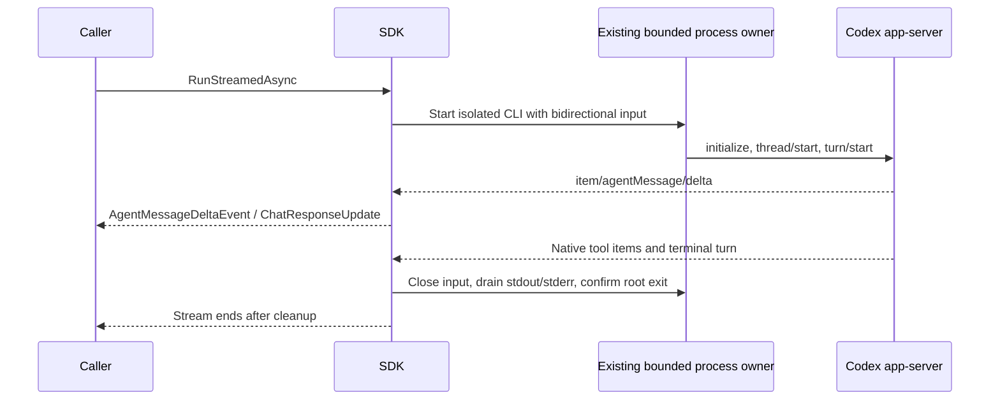

# ADR 005: native live text streaming

Status: accepted for the creator-requested SDK streaming repair, 2026-10-22.

## Context and decision

The exec JSONL output reports completed assistant items. Splitting those strings after completion does not provide live generation. `CodexThread.RunStreamedAsync` therefore drives the official app-server initialize, thread start/resume and turn start lifecycle. `RunAsync` and low-level `CodexExec` keep their complete-run exec semantics.

The process implementation is shared: no alternate cleanup runner, unbounded output collector or copied execution lifetime was added. A bounded input channel carries protocol requests. Cancellation/disposal completes that channel and joins the same existing process/pipe cleanup. Stream consumption drains through EOF before provider-failure exit evidence is exposed.

The adapter tracks text by native item identity. Deltas append immediately; updated/completed snapshots provide only an unstreamed suffix. A divergent snapshot is an explicit failure. Native tool payloads remain typed SDK data, while Prostir projects only their fixed safe activity categories. Interactive requests are declined or rejected, never auto-approved by the headless adapter.

## Acceptance

1. A real installed CLI emits a text delta before terminal completion.
2. The MEAI consumer sees text and native file-tool activity, and an independent filesystem read proves the requested file effect.
3. Completion does not duplicate text; provider failures drain the source before confirmed-exit failure evidence.
4. Concurrent calls use independent native chats/processes; cancellation and retained-pipe failures preserve cleanup evidence.
5. Explicit execution permissions and environment isolation survive the transport change. Unsupported exec-only presentation arguments fail before a turn starts.

Evidence owners: `RealCodexIntegrationTests`, `StreamingEventMapperTests`, `SharedChatClientConcurrencyTests`, and `ProviderFailureProcessTests`. The complete deterministic suite is required by CI; authenticated native tests are local qualification lanes.
