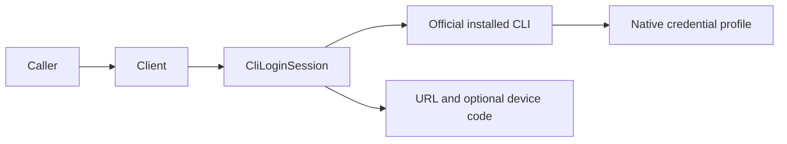

# ADR 006: Native CLI sign-in sessions

## Decision

Expose sign-in as an owned asynchronous session in the core SDK. Reuse CLI discovery, launch descriptors, execution environment policy and existing output/termination options. Native authentication owns OAuth and credential persistence; adapters do not implement another token store or exchange protocol.

The ordinary execution runner closes stdin after a prompt, while sign-in must keep bidirectional input and authorization state alive across a browser interaction. The dedicated session therefore owns a duplex native process, with one protocol reader and concurrent stdout/stderr pumps bounded by existing SDK options. No additional runtime dependency is required.

## Consequences

Applications retain and dispose the session. Server applications select separate native profiles for users. Observation cancellation is separate from sign-in cancellation. Code-entry retries return new native instructions. See [native sign-in](../Features/cli-login.md) for the provider-specific wire flow and verification limits.
