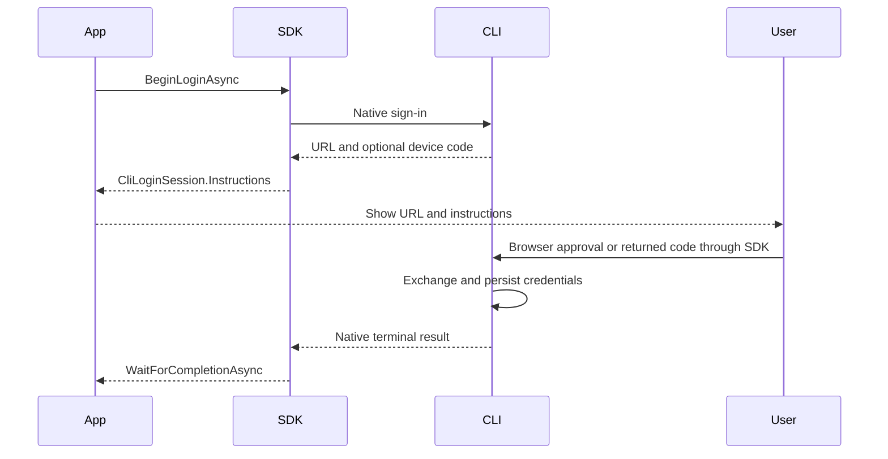

# Native CLI sign-in

The SDK starts the installed official CLI and keeps sign-in alive while an application presents the URL to its user. OAuth requests, PKCE state, token exchange, credential persistence and refresh remain owned by the CLI.

## Contract

- `CodexClient.BeginLoginAsync(token)` returns a `CliLoginSession` when instructions are available or cached credentials have completed authentication.
- `Instructions.LoginUrl` is the native HTTPS URL. `UserCode` is the device code, when required. Null `Instructions` means that the native CLI completed using cached credentials.
- `SubmitAuthorizationCodeAsync(code, token)` is available when `RequiresAuthorizationCode` is true. It returns null after successful completion, or fresh instructions if the native CLI retries with a new authorization URL. It rejects control characters, embedded whitespace and JSON-shaped input: a code is one plain input line, not a CLI/ACP message.
- `WaitForCompletionAsync(token)` requires native success and confirmed process cleanup. Cancelling this wait, or a submitted-code wait, stops observation only. The lifetime token passed to `BeginLoginAsync`, `CancelAsync` and disposal terminate the sign-in process.
- `CancelAsync` confirms shutdown. Authentication failures remain on the completion task; disposal does not repeat them. Cleanup failures still fail cancellation and disposal.
- The session owns its process independently of client connection state. Always dispose it. No provider tokens or raw CLI output are exposed or logged.
- Native stdout and stderr are consumed concurrently with the existing `MaximumProcessOutputCharacters` budget per stream. Shutdown uses the existing `ProcessTerminationTimeout`. The provider's deadline and the caller's lifetime token govern the sign-in duration.
- Launch descriptors and environment inheritance follow ordinary SDK execution. Servers select separate native profiles per user through `EnvironmentVariables` and reuse those profiles for subsequent agent calls. The SDK never copies credentials between profiles.

## Native transport

Codex runs `app-server`: `initialize` / `initialized`, then `account/login/start` with `type: chatgptDeviceCode`. The SDK presents `verificationUrl` and `userCode` and accepts only the matching `account/login/completed` success notification. See [OpenAI app-server authentication](https://learn.chatgpt.com/docs/app-server#3b-log-in-with-chatgpt-device-code-flow).

## Verification

`CliLoginTests` uses real installed CLIs in isolated repository-owned profiles. It verifies that help-only exit is not success, native instructions are usable, observation cancellation leaves sign-in running, and explicit cancellation stops the process without writing credentials. Code-entry flows reject transport injection before writing stdin.

Codex device-code challenge creation needs access to OpenAI authentication, so its instruction test uses the existing authentication-required test lane. A cancelled sign-in is not evidence of successful browser approval. Live approval and credential refresh require an authorized account and are reported separately.
